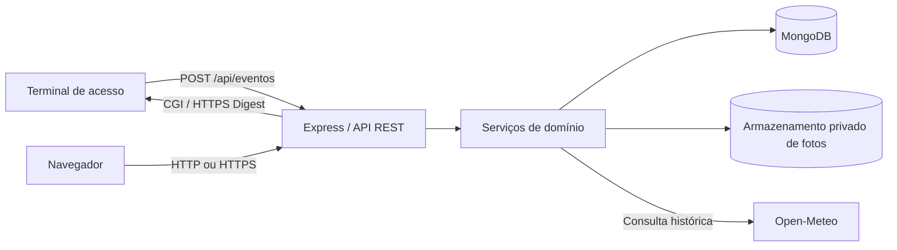

# Sistema de Controle e Gestão de Acessos

**Projeto acadêmico — Desenvolvimento de APIs**  
API REST e painel web para integração, consulta e auditoria de eventos de controle de acesso.

> Esta distribuição é uma versão acadêmica e demonstrativa. Ela não contém credenciais, certificados, fotografias, backups ou endereços de rede de uma instalação real. Antes de usar com um equipamento físico, configure o ambiente e valide a compatibilidade com o firmware utilizado.

## Visão geral

O sistema recebe notificações de um terminal de controle de acesso, normaliza os dados enviados, armazena os eventos em MongoDB e disponibiliza consultas por meio de uma API HTTP. Uma interface web permite acompanhar movimentações, pesquisar funcionários, consultar históricos individuais, gerar relatórios e revisar ocorrências faciais não identificadas.

O reconhecimento facial é executado pelo equipamento integrado. A aplicação **não implementa um modelo próprio de reconhecimento facial** e não tenta identificar automaticamente pessoas desconhecidas. Quando recebe uma fotografia associada a uma tentativa facial local negada e sem identificador de usuário, o sistema pode armazená-la em área privada para revisão humana.

## Funcionalidades implementadas

- Recepção de notificações do equipamento por `POST /api/eventos`, incluindo conteúdo `multipart/mixed`, `multipart/form-data` e `multipart/related`.
- Interpretação e normalização dos eventos e associação de fotografias anexadas.
- Persistência de eventos e cadastros em MongoDB, com chaves e índices para reduzir duplicidades.
- Dashboard com movimentações diárias, relatórios mensais e exportação CSV.
- Pesquisa de funcionários e ficha individual com histórico, indicadores, frequência e paginação.
- Consulta de dados meteorológicos históricos estimados para entradas liberadas, por meio da Open-Meteo, quando coordenadas são configuradas.
- Importação de cadastros a partir de CSV exportado do equipamento, com modo de simulação e confirmação explícita.
- Integração administrativa de saída com o equipamento por HTTPS e autenticação HTTP Digest.
- Cadastro de novos usuários comuns, envio de fotografia facial e atualização de fotografia de funcionário existente, mediante sessão administrativa.
- Recebimento protegido de fotografias de tentativas faciais não identificadas, armazenamento fora da pasta pública e revisão humana.
- Auditoria de operações biométricas e limpeza automática de fotografias/ocorrências após o período de retenção configurado.
- Layout responsivo para uso em computadores e dispositivos móveis.

## Tecnologias

| Camada | Tecnologia |
|---|---|
| Runtime | Node.js (20.19.0 ou superior) |
| API e servidor web | Express 5 |
| Interface | EJS, HTML, CSS e JavaScript |
| Banco de dados | MongoDB, por meio do driver oficial para Node.js |
| Configuração | dotenv |
| Comunicação segura | HTTPS/TLS |
| Testes | Node.js Test Runner (`node:test`) |
| Integração do equipamento | HTTP Digest sobre HTTPS e webhook HTTP/HTTPS |
| Dados meteorológicos | Open-Meteo APIs |

## Arquitetura resumida



A comunicação de entrada do webhook e a comunicação administrativa de saída são independentes. Consulte [Arquitetura](docs/ARQUITETURA.md) e [Ativar HTTPS e fotos](docs/ATIVAR-HTTPS-E-FOTOS.md).

## Estrutura do repositório

```text
.
├── docs/                    # Documentação acadêmica e operacional
├── public/                  # CSS e JavaScript do navegador
├── routes/                  # Rotas Express (dashboard e biometria)
├── scripts/                 # Importação CSV e configuração HTTPS/Firewall
├── services/                # Regras de negócio e integrações
├── tests/                   # Testes automatizados
├── views/                   # Templates EJS
├── .env.example              # Modelo sem credenciais
├── .gitignore
├── openapi.yaml              # Contrato descritivo da API
├── package.json
└── server.js                 # Inicialização e composição da aplicação
```

## Requisitos para executar

- Node.js 20.19.0 ou superior e npm.
- MongoDB local ou uma instância MongoDB acessível pela rede.
- Para integração física: equipamento compatível, conectividade IP e credenciais próprias do ambiente.
- Para HTTPS: certificado e chave/PFX válidos e aceitos pelos clientes que farão a conexão.

## Instalação local

1. Clone ou extraia o repositório.
2. Instale as dependências:

   ```bash
   npm install
   ```

3. Crie uma cópia local do modelo de configuração:

   **Windows PowerShell**
   ```powershell
   Copy-Item .env.example .env
   ```

   **Linux/macOS**
   ```bash
   cp .env.example .env
   ```

4. Edite `.env` e configure, no mínimo, `MONGODB_URI`, `MONGODB_DB`, `BIOMETRIA_ADMIN_USER`, `BIOMETRIA_ADMIN_PASSWORD` e `BIOMETRIA_SESSION_SECRET`.
5. Gere um segredo de sessão localmente:

   ```bash
   node -e "console.log(require('node:crypto').randomBytes(48).toString('base64url'))"
   ```

6. Execute os testes:

   ```bash
   npm test
   ```

7. Inicie a aplicação:

   ```bash
   npm start
   ```

8. Acesse `http://localhost:3000` no navegador.

A área administrativa biométrica exige HTTPS em conexões remotas. Sem certificado configurado, o servidor mantém o HTTP e informa que o HTTPS está indisponível. Para gerar um certificado local de desenvolvimento no Windows, consulte [Ativar HTTPS e fotos](docs/ATIVAR-HTTPS-E-FOTOS.md). Um certificado local não é automaticamente confiável por todos os dispositivos; valide a cadeia de confiança antes de alterar o webhook do equipamento.

## Configuração das variáveis

O arquivo `.env.example` documenta todas as variáveis. As principais são:

| Variável | Finalidade |
|---|---|
| `PORT` | Porta HTTP da aplicação (padrão 3000) |
| `MONGODB_URI` / `MONGODB_DB` | Conexão e nome do banco |
| `INTELBRAS_DEVICE_URL` | URL HTTPS para comunicação de saída com o equipamento |
| `INTELBRAS_DEVICE_USER` / `INTELBRAS_DEVICE_PASSWORD` | Credenciais de integração do equipamento |
| `INTELBRAS_CA_PATH` | CA confiável para a conexão Node.js → equipamento, quando necessária |
| `INTELBRAS_WEBHOOK_IPS` | Lista dos IPs autorizados a enviar notificações |
| `HTTPS_PORT` | Porta HTTPS (padrão 3443) |
| `HTTPS_PFX_PATH` / `HTTPS_PFX_PASSPHRASE` | Certificado PFX e senha, ou alternativa PEM |
| `BIOMETRIA_ADMIN_*` | Conta e segredo da sessão administrativa |
| `BIOMETRIA_STORAGE_DIR` | Diretório privado de fotografias |
| `BIOMETRIA_RETENCAO_DIAS` | Prazo de retenção das ocorrências (padrão 30 dias) |
| `CLIMA_LATITUDE` / `CLIMA_LONGITUDE` | Coordenadas da localidade usada na consulta meteorológica |
| `CLIMA_TIMEZONE` | Fuso horário da aplicação |

Nunca publique `.env`, `certs/`, `storage/`, fotografias, planilhas de funcionários ou backups. O `.gitignore` já contempla esses caminhos e extensões, mas revise `git status` antes de cada publicação.

## API REST

O inventário das rotas, parâmetros, autenticação e respostas está em [Referência da API](docs/API.md). O contrato OpenAPI está em [`openapi.yaml`](openapi.yaml).

Rotas principais:

| Método | Rota | Descrição |
|---|---|---|
| `GET` | `/api/status` | Estado da aplicação e do banco |
| `POST` | `/api/eventos` | Webhook de eventos do equipamento |
| `GET` | `/api/eventos` | Consulta dos eventos recentes |
| `GET` | `/api/dashboard/resumo` | Resumo diário |
| `GET` | `/api/relatorios/mensal` | Relatório mensal |
| `GET` | `/api/funcionarios` | Pesquisa de funcionários |
| `GET` | `/api/funcionarios/{userId}/movimentacoes` | Histórico individual |
| `GET` | `/api/biometria/ocorrencias` | Ocorrências faciais (administrador) |
| `PATCH` | `/api/biometria/ocorrencias/{id}/revisao` | Revisão humana de ocorrência (administrador) |

## Testes

Execute `npm test`. No pacote acadêmico preparado em 12/11/2026, a suíte executou **42 testes, com 42 aprovações e nenhuma falha**. Os testes cobrem parsing multipart, associação de imagens, regras de classificação, validações, integração de funções de domínio, relatórios, importação CSV e consulta meteorológica simulada.

Os testes automatizados não substituem testes de integração com o modelo físico do equipamento, rede, certificados e firmware específico.

## Limitações e trabalhos futuros

- A detecção de pedestres por câmera de CFTV **não está implementada** nesta versão. Não existe análise de RTSP/ONVIF nem classificador de veículo/pedestre.
- A aplicação não realiza reconhecimento facial próprio nem identifica automaticamente pessoas desconhecidas.
- As rotas gerais de consulta do dashboard e eventos não possuem autenticação individual nesta versão. A implantação deve ficar em rede controlada; antes de exposição fora da LAN, é necessário implementar autorização e controles adicionais.
- A aceitação de certificado privado pelo firmware do terminal depende do equipamento e não é garantida pelo código.
- A base legal, transparência, retenção e direitos dos titulares devem ser avaliados pelo responsável pela proteção de dados antes de qualquer operação real.

Veja o [Roadmap](docs/ROADMAP.md), [Segurança e privacidade](docs/SEGURANCA-E-PRIVACIDADE.md), o [Relatório técnico-acadêmico](docs/RELATORIO-ACADEMICO.md) e o [guia de publicação no GitHub](docs/PUBLICAR-GITHUB.md).

## Contexto acadêmico

Trabalho técnico para a componente **Desenvolvimento de APIs**. Preencha nome do estudante, instituição, docente e demais informações acadêmicas na versão do relatório destinada à entrega. O repositório não inclui dados reais de funcionários, credenciais ou fotografias.
