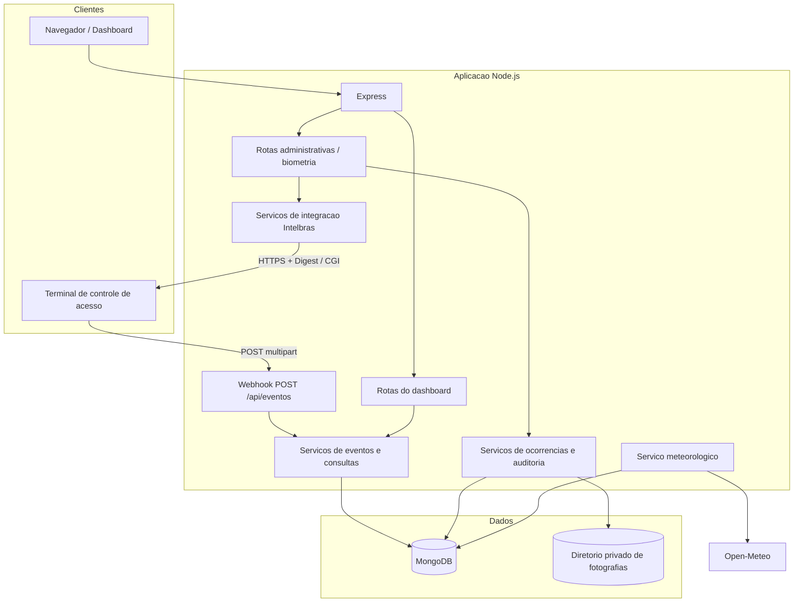

# Arquitetura do sistema

## 1. Visão arquitetural

A aplicação utiliza uma arquitetura em camadas, organizada em rotas HTTP, serviços de domínio, camada de persistência e interface web renderizada no servidor.

- **Apresentação:** páginas EJS, CSS e JavaScript no diretório `public/`.
- **Interface HTTP:** rotas Express agrupadas em `server.js`, `routes/dashboard.js` e `routes/biometria.js`.
- **Serviços de domínio:** normalização de eventos, relatórios, integração com equipamento, importação CSV, auditoria, segurança e tratamento de fotografias.
- **Persistência:** MongoDB para eventos e metadados; sistema de arquivos privado para as fotografias de ocorrências.
- **Integrações externas:** terminal Intelbras e serviços meteorológicos Open-Meteo.

## 2. Diagrama de componentes

## 3. Fluxo de recebimento de eventos

1. O terminal envia um `POST` para `/api/eventos`.
2. O Express preserva o corpo multipart como `Buffer`, evitando conversões que corrompam os bytes de imagem.
3. `intelbras-notificacao-service.js` separa as partes textuais e binárias, interpreta o payload e associa imagens aos eventos.
4. `evento-service.js` normaliza cada evento, gera uma chave de idempotência SHA-256 e persiste o registro em `eventos_acesso` usando `upsert`.
5. Quando o evento tem usuário identificado, o cadastro local de funcionário é criado/atualizado.
6. Uma foto somente segue para a rotina de ocorrência quando a requisição está em canal seguro e o IP de origem está na lista autorizada.
7. `ocorrencia-facial-service.js` aplica as regras de elegibilidade, valida assinatura JPEG/PNG e tamanho, armazena o arquivo fora de `public/` e grava seus metadados em `ocorrencias_face`.
8. O servidor responde `200 OK` quando os eventos foram processados. Uma falha no armazenamento da foto é registrada sem apagar o evento textual.

## 4. Integrações em sentidos diferentes

Há dois canais que não devem ser confundidos:

- **Entrada — terminal → Node.js:** notificações POST de eventos, com multipart e fotografias. O listener HTTP pode receber eventos textuais; a fotografia só é armazenada quando HTTPS e autorização por IP são atendidos.
- **Saída — Node.js → terminal:** consultas e operações CGI via HTTPS, utilizando autenticação Digest e validação do certificado do equipamento. `INTELBRAS_CA_PATH` pode apontar para a CA confiável quando necessário.

A configuração TLS de um canal não habilita automaticamente o outro.

## 5. Inicialização

O servidor:

1. Carrega as variáveis de ambiente com `dotenv`.
2. Conecta ao MongoDB e cria os índices necessários.
3. Executa uma limpeza inicial das ocorrências expiradas e agenda uma nova execução periódica a cada seis horas.
4. Inicia o listener HTTP na porta `PORT`.
5. Quando existe um certificado PFX ou um par PEM configurado, inicia também o listener HTTPS na porta `HTTPS_PORT`.

Se a configuração HTTPS falhar, o HTTP continua ativo e o console registra o problema. Essa tolerância mantém a interface geral acessível, mas não significa que funções biométricas remotas estejam disponíveis.

## 6. Organização dos módulos

| Diretório/arquivo | Responsabilidade |
|---|---|
| `server.js` | Composição do Express, webhook, listeners HTTP/HTTPS e limpeza periódica |
| `routes/dashboard.js` | Rotas de resumo, relatórios, funcionários e clima |
| `routes/biometria.js` | Login administrativo, cadastro facial, usuários e revisão de ocorrências |
| `services/db.js` | Conexão MongoDB e índices |
| `services/evento-service.js` | Normalização e persistência idempotente de eventos |
| `services/intelbras-notificacao-service.js` | Parsing multipart e associação de fotografias |
| `services/intelbras-device-service.js` | Comunicação CGI/HTTPS Digest com o terminal |
| `services/consulta-service.js` | Resumos, relatórios, histórico e CSV |
| `services/ocorrencia-facial-service.js` | Elegibilidade, armazenamento privado, revisão e retenção |
| `services/seguranca-biometria-service.js` | Sessão administrativa, assinatura e middlewares |
| `services/clima-service.js` | Consulta e cache de estimativas meteorológicas |
| `views/` | Templates EJS |
| `public/` | Recursos do navegador |
| `tests/` | Testes automatizados |
